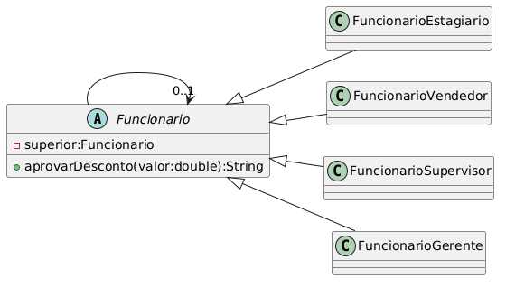
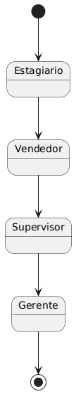

# ChainOfResponsability-DCC078-2026-3-A
## Content:
Exemplo simplificado do padrão Chain of Responsability, no qual cada funcionario possui um limite máximo no percentual de desconto.
## Diagrams:

